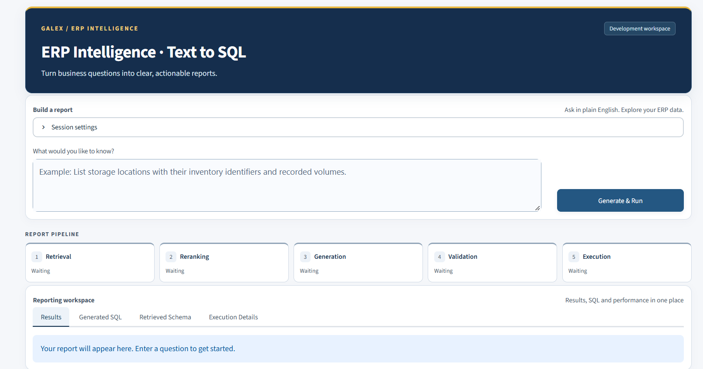

# ERP Text-to-SQL with Retrieval-Augmented Generation

This repository contains a small public version of my computer engineering bachelor's project. It explores how natural-language reporting questions can be translated into Microsoft SQL Server T-SQL using retrieved schema context. ERP databases are difficult to navigate because abbreviated identifiers, many related tables, and business-specific relationships make the right source hard to identify.

I implemented schema retrieval, foreign-key expansion, reranking, grounded SQL prompting, validation, and a reporting interface. This edition keeps the reusable components and synthetic examples while leaving company schemas, connection details, and development records outside the repository.



*Development interface; the public demo uses a simplified synthetic UI.*

```text
Question → BGE-M3 dense retrieval + MiniLM hybrid/FK retrieval
         → candidate union → BGE reranking → selected schema
         → Qwen SQL generation → validation → authorized preview
```

BGE-M3 provides one dense retrieval branch. The second combines MiniLM similarity with identifier-based lexical matching at a 70/30 weighting, then expands outgoing foreign keys by one hop. Candidates from both branches are deduplicated and ranked with BGE-Reranker-v2-M3. The default context contains up to ten tables. Qwen2.5-Coder-7B-Instruct receives their exact columns and relationships; oversized prompts are rejected rather than silently truncated. No model fine-tuning is included.

The SQL validator checks T-SQL syntax, schema references, table scope, named parameters, and forbidden operations. The optional SQL Server adapter requires explicit authorization, binds values separately, uses encrypted connections, limits previews, and rolls back before closing. A database login with restricted read permissions remains essential.

The main tools are Python, SentenceTransformers, Transformers/PyTorch, FAISS, SQLGlot, pyodbc, and Streamlit. With Python 3.11, run from the repository root:

```powershell
python -m venv .venv
.\.venv\Scripts\python.exe -m pip install -r requirements.txt
.\.venv\Scripts\python.exe -m streamlit run streamlit_app.py
```

The demo uses fixed synthetic questions, SQL, and preview rows. It runs real static validation without loading models or connecting to a database. [Optional component setup](docs/COMPONENTS.md) explains model and SQL Server integration. Business ambiguity, incomplete schema context, model memory requirements, and CPU reranking latency remain limitations; static checks cannot establish whether a query answers the intended business question.
